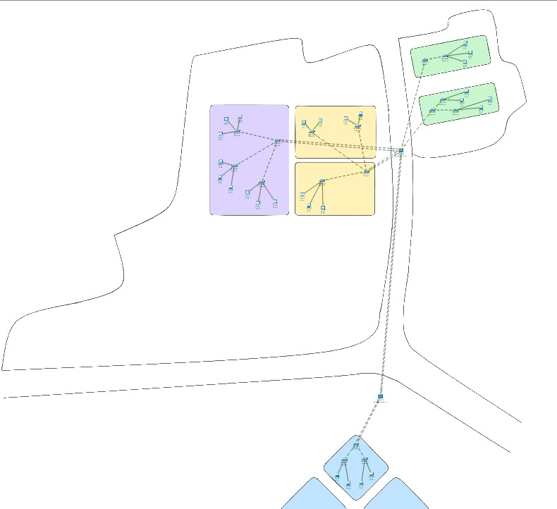
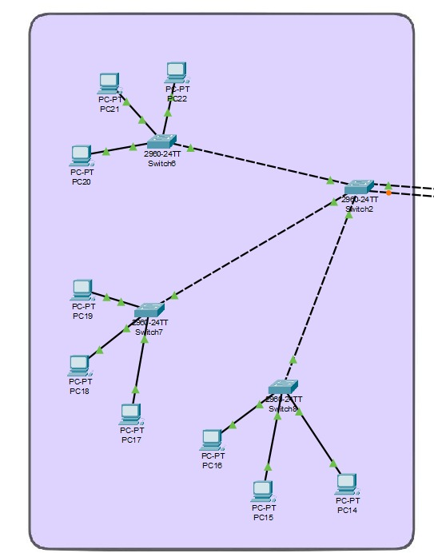
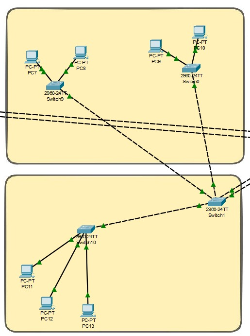
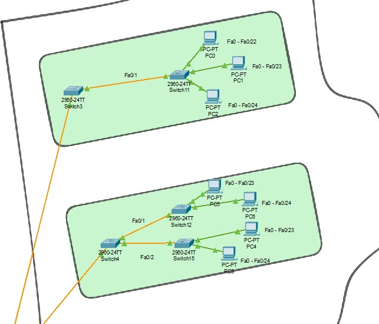
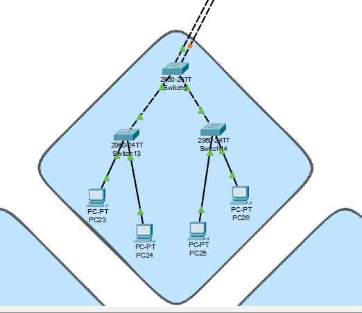

# Manual Técnico Practica 2
## Red de la Ciudad Comercial Cayalá
### Jorge Ivan Samayoa SIan
### 202307506
### Universidad de San Carlos de Guatemala
### Ingenieria en Sistemas
### Laboratorio de Redes de Computadoras 1

 

---

 

# Contenido

1. ### Introducción
2. ### Topología completa y por sección
3. ### Justificación de la Topología
4. ### Estructura de VLANs y Direccionamiento IP
5. ### Dominios de Colision
6. ### Configuración de Protocolos Capa 2
7. ### Proceso de implementación
8. ### Problemas encontrados y soluciones

 

## 1. Introducción

El presente manual detalla el diseño de la topología para la red de comunicaciones del complejo urbano Cayalá, la cual se plantea mediante el despliegue de una arquitectura híbrida y jerárquica que interconecta cinco zonas reales y operativas del complejo (Distrito Moda, Distrito Empresarial, y las torres residenciales/comerciales de Nogales y Candales). Dicha topología introduce un backbone central de alta capacidad mediante switches multicapa, segmentación lógica de tráfico adaptada a la carga de cada área a través de VLANs, administración centralizada mediante el protocolo VTP, prevención de bucles con Rapid PVST+ y redundancia de enlaces de alta disponibilidad utilizando EtherChannel (LACP), garantizando de esta manera la conectividad extremo a extremo a nivel de la capa de enlace de datos (Capa 2) del modelo OSI.

## 2. Topología completa y por sección.

### 2.1 Topología completa

### 2.2 Distrito moda

### 2.3 Distrito empresarial

### 2.4 Torre Norte y Sur (Candales de Cayalá)

### 2.5 Torre A aparamentos (Nogales de Cayalá)

## 3. Justificación de la Topología

Se diseñoe implementó una **topología hibrida** en formato de estrella jerárquica, interconectando 5 zonas reales del complejo Cayalá mediante switches multicapa y switches de capa 2. No se aplicó un esquema uniforme sino que se aplicó un esquema adaptativo según la zona y sus roles operativos. 

* **Núcleo de Distribución:** Debido a a amplia separación física entre las zonas comerciales/empresariales y los apartamentos, se utilizaron dos switches multicapa interconectados para enlazar los extremos de la red. 

* **Zona 1 (Distrito Moda) y Zona 4 (Distrito Empresarial):** Por su alto volumen de tráfico, el switch troncal de estas zonas se conectó al Multilayer mediante EtherChannel y se subdividió en 3 switches de acceso para solventar la capacidad física de los puertos.

* **Zona 3 (Candales Torre Sur):** Se catalogó como de **zona crítica** por albergar servicios bancarios. Para cumplir con los estándares de *alta disponibilidad*, se le asignan 2 enlaces físicos redundantes hacia el Multiplayer, previniendo interrupciones de operación.

* **Zona 2 (Nogales) y 5 (Candales Torre Norte):** Se utilizaron enlaces y cantidades de switches de acceso acordes a su carga media/baja de tráfico (residencial y servicios médicos).

## 4. Estructura de VLANs y Direcciones IP

Dado que el identificador de las VLANs operativas termina en **6**, correspondiente al último dígito del carnet. Se utilizó un direccionamiento de clase C (/24) para facilitar la segmentación y escalabilidad. 

| Zona | VLAN ID | Nombre | Hosts Requeridos | Red Lógica | Default Gateway |
| :--- | :--- | :--- | :--- | :--- | :--- |
| Zona 1 | 16 | Distrito_Moda | 60 | 192.168.16.0 /24 | 192.168.16.1 |
| Zona 2 | 26 | Nogales_Torre_A | 28 | 192.168.26.0 /24 | 192.168.26.1 |
| Zona 3 | 36 | Candales_Torre_Sur| 12 | 192.168.36.0 /24 | 192.168.36.1 |
| Zona 4 | 46 | Distrito_Empresarial| 50 | 192.168.46.0 /24 | 192.168.46.1 |
| Zona 5 | 56 | Candales_Torre_Norte| 7 | 192.168.56.0 /24 | 192.168.56.1 |
| Admin | 99 | Nativa | - | 192.168.99.0 /24 | N/A |
| Seg. | 999 | Blackhole | - | N/A | N/A |

## 5. Dominios de Colisión

En la siguiente tabla se detallan los dominios de colisión generados por los puertos activos de cada dispositivo

| Dispositivo de Red | Ubicación | Puertos Activos | Dominios de Colisión Generados |
| :--- | :--- | :---: | :---: |
| Multilayer 0 | Núcleo Principal | 8 | 8 |
| Multilayer 1 | Núcleo Secundario | 4 | 4 |
| Switch0 | Distrito Empresarial (Acceso) | 3 | 3 |
| Switch1 | Distrito Empresarial (Trunk) | 5 | 5 |
| Switch2 | Distrito Moda (Trunk) | 5 | 5 |
| Switch3 | Candales Torre Norte (Troncal) | 2 | 2 |
| Switch4 | Candales Torre Sur (Troncal) | 3 | 3 |
| Switch5 | Nogales Torre A (Troncal) | 4 | 4 |
| Switch6 | Distrito Moda (Acceso) | 4 | 4 |
| Switch7 | Distrito Moda (Acceso) | 4 | 4 |
| Switch8 | Distrito Moda (Acceso) | 4 | 4 |
| Switch9 | Distrito Empresarial (Acceso) | 3 | 3 |
| Switch10 | Distrito Empresarial (Acceso) | 4 | 4 |
| Switch11 | Candales Torre Norte (Acceso) | 4 | 4 |
| Switch12 | Candales Torre Sur (Acceso) | 3 | 3 |
| Switch13 | Nogales Torre A (Acceso) | 3 | 3|
| Switch14 | Nogales Torre A (Acceso) | 3 | 3 |
| Switch15 | Candales Torre Sur (Acceso) | 3 | 3 |
| **Total Exacto** | **Infraestructura de Cayalá** | **65 Puertos Activos** | **65** |

## 6. Configuración de Protocolos Capa 2

*   **VLAN Trunks y Seguridad:** Todos los enlaces entre switches se configuraron como *trunk* permitiendo exclusivamente las VLANs 16, 26, 36, 46, 56 y 99. La VLAN 99 opera como nativa. Los puertos no utilizados fueron apagados y asignados a la VLAN 999 (Blackhole).
*   **VTP:** Se estableció el dominio `202307506`. Los switches principales de cada zona (y los multicapa) operan como *VTP Server*, mientras que los switches de acceso final operan en modo *VTP Client*.
*   **STP (Rapid PVST+):** Se implementó este protocolo para mitigar bucles físicos, especialmente en los enlaces redundantes de la Zona 3 (Alta Disponibilidad). Cada switch principal fue forzado como *Root Bridge* para su VLAN correspondiente manipulando el valor de `priority`.
*   **EtherChannel:** Dado que el carnet termina en dígito par (6), se implementó **LACP (IEEE 802.3ad)**. Se aplicó entre los switches Multicapa y en las conexiones troncales de las Zonas 1 y 4 para multiplicar el ancho de banda y manejar el volumen de tráfico sin cuellos de botella.

## 7. Proceso de implementación

1.  **Cableado Físico:** Se colocaron los dispositivos aplicando la norma TIA/EIA-568B. Se utilizaron cables *crossover* entre los switches troncales y los multicapa, y cables *straight-through* para conectar las PCs de muestra a los switches de acceso.
2.  **Configuración de Core y Distribución:** Se agruparon las interfaces entre los Multilayers mediante LACP y se habilitó el modo *trunk*.
3.  **Configuración de VLANs y VTP:** Se crearon las VLANs requeridas en los servidores VTP, dejando que se propagaran automáticamente a los switches de acceso.
4.  **Afinación de STP:** Se configuraron manualmente las prioridades de STP en los switches principales de cada zona para que retuvieran el control lógico del *spanning-tree* de su segmento.
5.  **Asignación de Puertos (Access):** Se asignaron las interfaces correspondientes de los switches de acceso a las VLANs de cada zona, y se movió el resto de puertos a la VLAN 999.
6.  **Direccionamiento:** Se configuraron IPs estáticas a los hosts de prueba de cada zona.

## 8. Problemas encontrados y soluciones

*   **Problema 1 - Limitación Física de Puertos:** Las Zonas 1 y 4 requieren conectar 60 y 50 hosts respectivamente, pero los switches 2960 poseen solo 24 puertos FastEthernet.
    *   *Solución:* Se amplió la capa de acceso colocando 3 switches de acceso conectados al switch principal de la zona. Para evitar la saturación del enlace ascendente, se implementó un EtherChannel (LACP) desde el switch principal de la zona hacia el núcleo.
*   **Problema 2 - Distancia irreal para enlaces de cobre:** La distancia estimada entre las zonas del complejo excede los 100 metros soportados por el UTP estándar.
    *   *Solución técnica:* Aunque en la simulación se agrupó mediante FastEthernet/GigabitEthernet en cobre, en un despliegue real esta interconexión central se sustituiría por fibra óptica monomodo (SFP) para justificar la topología y asegurar latencias mínimas.