<div align="center">

# Manual Técnico Proyecto 1
## SmartCity Tech Park
### Jorge Ivan Samayoa SIan
### 202307506
### Universidad de San Carlos de Guatemala
### Ingenieria en Sistemas
### Laboratorio de Redes de Computadoras 1

</div>

<br>

---

<br>

# Contenido

1. ### Introducción
2. ### Topología completa y por sección
3. ### Análisis de dominios de Colisión
4. ### Análisis de dominios de Broadcast
5. ### Comandos de configuración
6. ### Tabla de VLANS
7. ### Tabla de asignación de puertos
8. ### Justificación de diseños y protocolos
9. ### Justificación de medios de transmisión
10. ### Presupuesto de Implementación
11. ### Evidencias y Diagnóstico

<br>

## 1. Introducción

El presente manual detalla el diseño de la topología para la red de comunicaciones del complejo "SmartCity Tech Park", la cual se plantea mediante un despliegue de una arquitectura jerárquica que interconecta las cuatro áreas principales del complejo. Dicha topología introduce un backbone de alta capacidad, segmentación lógica de tráfico a través de VLANs, administración centralizada mediante protocolo VTP, prevención de bucles con Spanning Tree Protocol y redundancia de enlaces utilizando Etherchannel, cubriendo de esta manera la Capa 1 y Capa 2 del modelo OSI. 

## 2. Topología completa y por sección

### 2.1 Topología completa

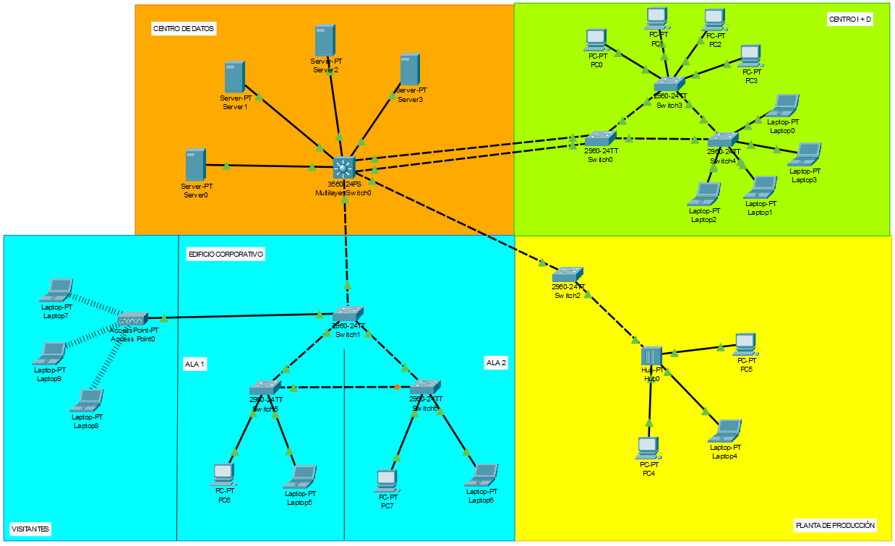

### 2.2 Centro de Datos (CORE)

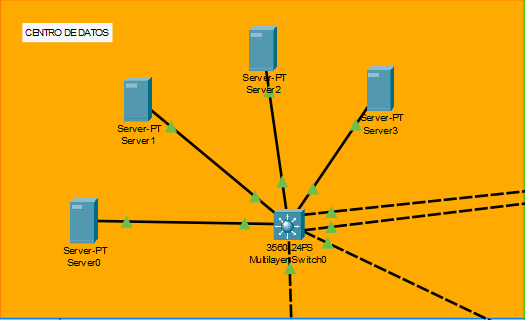


### 2.3 Centro de Investigación y Desarrollo (I+D)

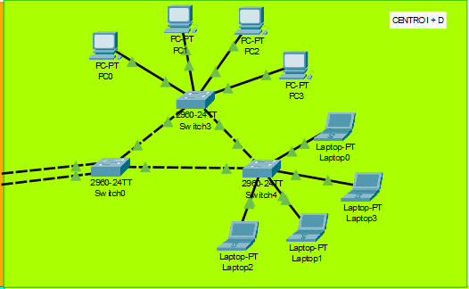

### 2.4 Edicicio Corporativo

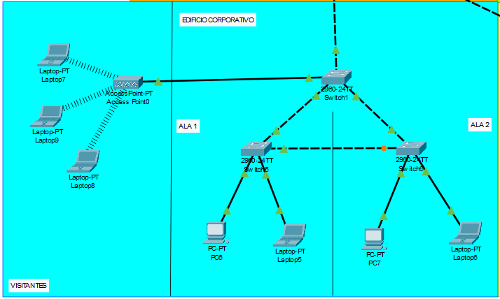

### 2.5 Planta de Producción (Legacy)

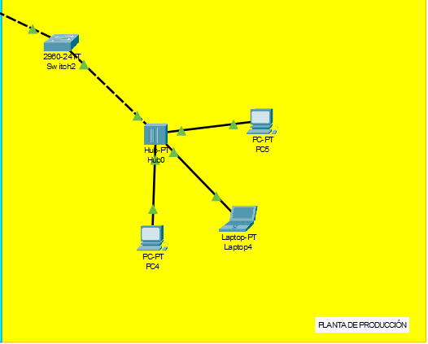

## 3. Análisis de Dominios de Colisión

En la siguiente tabla se detallan los dominios de colisión generados por los puertos activos de cada dispositivo de red.

| Dispositivo de Red | Ubicación | Puertos Activos | Dominios de Colisión Generados |
| :--- | :--- | :---: | :---: |
| Multilayer Switch0 | Centro de Datos (Core) | 7 | 7 |
| Switch0 | Centro de I+D (Distribución) | 3 | 3 |
| Switch1 | Edificio Corporativo (Distribución) | 4 | 4 |
| Switch2 | Planta de Producción | 2 | 2 |
| Switch3 | Centro de I+D (Acceso) | 6 | 6 |
| Switch4 | Centro de I+D (Acceso) | 6 | 6 |
| Switch5 | Edificio Corporativo (Acceso) | 4 | 4 |
| Switch6 | Edificio Corporativo (Acceso) | 4 | 4 |
| **Hub0 (Legacy)** | **Planta de Producción** | **4** | **1 (Compartido en Capa 1)** |

**Análisis del Segmento Legacy:**
Debido a que la Planta de Producción, se encuentra conectada a un Hub, las computadoras y el enlace hacia el Switch2 comparten un único dominio de colisión. Esto significa que si dos equipos intentan transmitir al mismo tiempo, los datos colisionarán. Sin embargo, el Switch2 actúa como una barrera de contención en su puerto de acceso, evitando que estas colisiones afecten el rendimiento del resto de la red corporativa.

## 4. Análisis de dominios de Broadcast

A continuación, se detallan los dominios de broadcast y debido al diseño de Capa 2, cada VLAN activa representa un dominio aislado e independiente, conteniendo el tráfico de difusión a sus respectivos equipos. 

| VLAN  | Nombre de la VLAN | Ubicación  | Dominios de Broadcast |
| :---: | :--- | :--- | :---: |
| 16 | Gerencia | Edificio Corporativo | 1 |
| 26 | Investigacion | Centro de I+D | 1 |
| 36 | Produccion | Planta de Producción | 1 |
| 46 | Servidores | Centro de Datos (Core) | 1 |
| 56 | Visitantes | Edificio Corporativo (Inalámbrico) | 1 |
| 96 | Nativa | Backbone (Enlaces Troncales) | 1 |
| **Total** | | | **6 Dominios** |

**Análisis de Aislamiento:**
La implementación de VLANs garantiza que un paquete de difusión originado en la Planta de Producción (VLAN 36) sea contenido exclusivamente dentro de su área. El tráfico no atravesará los enlaces troncales hacia el resto de los edificios a menos que sea enrutado en Capa 3, cumpliendo con el objetivo de aislamiento inter-VLAN requerido.

## 5. Comandos de Configuración

En el siguiente apartado se detallarán todos los comandos usados para lograr la configuración requerida. 

### 5.1 Centro de Datos (Switch Multicapa - CORE)

```bash
    enable
    configure terminal

    # Configuración básica de seguridad
    banner motd #Acceso Restringido - TechPark_202307506#

    # Configuración VTP (Server)
    vtp domain Smart_0
    vtp password proyecto12S2026
    vtp mode server

    # Creación de VLANs
    vlan 16
        name Gerencia
    vlan 26
        name Investigacion
    vlan 36
        name Produccion
    vlan 46
        name Servidores
    vlan 56
        name Visitantes
    vlan 96
        name Nativa  

    # Prevención de bucles (PVST y ROOT BRIDGE)
    spanning-tree mode pvst
    spanning-tree vlan 16,26,36,46,56,96 root primary

    # Enlaces con Protocolo LACP hacia I+D
    interface range GigabitEthernet0/1-2
        switchport trunk encapsulation dot1q
        switchport mode trunk
        switchport trunk native vlan 96
        channel-protocol lacp
        channel-group 1 mode active
        no shutdown

    # Enlaces troncales
    interface range FastEthernet0/23-24
        switchport trunk encapsulation dot1q
        switchport mode trunk
        switchport trunk native vlan 96
        no shutdown

    # Puertos de acceso para los Servidores
    interface range FastEthernet0/1-4
        switchport mode access
        switchport access vlan 46
        no shutdown
```

### 5.2 Centro de Investigación I+D (Switch 0, 3 y 4)

```bash
    enable
    configure terminal

    # Configuración básica de seguridad (Switch 0 - Distribución)
    banner motd #Acceso Restringido - TechPark_202307506#

    # Configuración VTP (Cliente)
    vtp domain Smart_0
    vtp password proyecto12S2026
    vtp mode client
    spanning-tree mode pvst   

    # Enlaces con Protocolo LACP (Switch 0 - CORE)
    interface range GigabitEthernet0/1-2
        switchport mode trunk
        switchport trunk native vlan 96
        channel-protocol lacp
        channel-group 1 mode active
        no shutdown

    # Enlaces troncales
    interface range FastEthernet0/23-24
        switchport trunk encapsulation dot1q
        switchport mode trunk
        switchport trunk native vlan 96
        no shutdown

    # Puertos de acceso para los dispositivos finales (Switch 3 y 4)
    interface range FastEthernet0/1-4
        switchport mode access
        switchport access vlan 26
        no shutdown
```

### 5.3 Edificio Corporativo (Switch 1, 5 y 6)

```bash
    enable
    configure terminal

    # Configuración básica de seguridad (Switch 1 - Distribución)
    banner motd #Acceso Restringido - TechPark_202307506#

    # Configuración VTP (Cliente)
    vtp domain Smart_0
    vtp password proyecto12S2026
    vtp mode client
    spanning-tree mode pvst   

    # Enlaces troncales (Switch 1 - CORE)
    interface range GigabitEthernet0/1
        switchport mode trunk
        switchport trunk native vlan 96
        no shutdown

    # Enlaces troncales internos
    interface range FastEthernet0/23-24
        switchport mode trunk
        switchport trunk native vlan 96
        no shutdown

    # Puerto de acceso para el Acces Point (Switch 1)
    interface range FastEthernet0/22
        switchport mode access
        switchport access vlan 56
        no shutdown  

    # Puertos de acceso para los dispositivos finales (Switch 5 y 6)
    interface range FastEthernet0/1-2
        switchport mode access
        switchport access vlan 16
        no shutdown
```
### 5.4 Planta de Producción (Switch 2)

```bash
    enable
    configure terminal

    # Configuración básica de seguridad (Switch 1 - Distribución)
    banner motd #Acceso Restringido - TechPark_202307506#

    # Configuración VTP (Cliente)
    vtp domain Smart_0
    vtp password proyecto12S2026
    vtp mode client
    spanning-tree mode pvst   

    # Enlaces troncales (Switch 2 - CORE)
    interface range GigabitEthernet0/1
        switchport mode trunk
        switchport trunk native vlan 96
        no shutdown

    # Puertos de acceso para los dispositivos finales (Hub)
    interface range FastEthernet0/1
        switchport mode access
        switchport access vlan 36
        no shutdown
```

## 6. Tabla de VLANs

| VLAN  | Nombre de la VLAN | Descripción / Uso |
| :---: | :--- | :--- |
| **16** | Gerencia | Segmento para el personal administrativo del Edificio Corporativo. |
| **26** | Investigacion | Segmento de alta disponibilidad para las estaciones de trabajo del Centro de I+D. |
| **36** | Produccion | Segmento industrial para la contención del dominio de colisión  (Legacy). |
| **46** | Servidores | Segmento aislado para los servidores alojados en el Centro de Datos. |
| **56** | Visitantes | Segmento exclusivo para invitados mediante conexión inalámbrica (Access Point). |
| **96** | Nativa | VLAN asignada para el tráfico y protocolos de control en los enlaces troncales. |

De acuerdo con el enunciado del proyecto, se usa el último dígito del carné, siendo este el 202307506, por lo que las terminaciones las VLANs son con el número 6

## 7. Tabla de asignación de puertos

| Ubicación / Switch | Interfaz (Puerto) | Modo de Operación | VLAN Asignada / Función |
| :--- | :--- | :--- | :--- |
| **Centro de Datos (Core)** | `Gig0/1 - Gig0/2` | Trunk (LACP) | Troncal (Nativa 96) - Hacia I+D |
| Multilayer Switch | `Fa0/23` | Trunk | Troncal (Nativa 96) - Hacia Producción |
| | `Fa0/24` | Trunk | Troncal (Nativa 96) - Hacia Corporativo |
| | `Fa0/1-4` | Access | VLAN 46 (Servidores) |
| **Centro de I+D** | `Gig0/1 - Gig0/2` | Trunk (LACP) | Troncal (Nativa 96) - Hacia Core |
| Switch 0 (Dist)| `Fa0/23-24` | Trunk | Troncal (Nativa 96) - Hacia Switch 3 y 4 |
| Switch 3 (Acc) | `Fa0/23-24` | Trunk | Troncal (Nativa 96) - Enlaces internos |
| | `Fa0/1-4` | Access | VLAN 26 (Investigacion) |
| Switch 4 (Acc) | `Fa0/23-24` | Trunk | Troncal (Nativa 96) - Enlaces internos |
| | `Fa0/1-4` | Access | VLAN 26 (Investigacion) |
| **Edificio Corporativo** | `Gig0/1` | Trunk | Troncal (Nativa 96) - Hacia Core |
| Switch 1 (Dist) | `Fa0/1-2` | Trunk | Troncal (Nativa 96) - Hacia Switch 5 y 6 |
| | `Fa0/24` | Access | VLAN 56 (Visitantes - Access Point) |
| Switch 5 (Acc)| `Fa0/23-24` | Trunk | Troncal (Nativa 96) - Enlaces internos |
| | `Fa0/1-2` | Access | VLAN 16 (Gerencia) |
| Switch 6 (Acc) | `Fa0/23-24`|  Trunk | Troncal (Nativa 96) - Enlaces internos |
| | `Fa0/1-2` | Access | VLAN 16 (Gerencia) |
| **Planta de Producción** | `Gig0/1` | Trunk | Troncal (Nativa 96) - Hacia Core |
| Switch 2 (Acc) | `Fa0/1` | Access | VLAN 36 (Produccion - Hacia Hub) |

## 8. Justificación de diseños y protocolos

### 8.1 Protocolo VTP

Para la administración centralizada de las VLANs, se configuró el dominio Smart_0  y la contraseña requerida proyecto12S2026. Se designó al Multilayer Switch (Centro de Datos) como el único equipo en modo VTP Server. Esta decisión se tomó para poder cumplir con las mejores prácticas del modelo de diseño jerárquico, ya que al centralizar la administración lógica en el Core de la red, se garantiza que cualquier modificación en la base de datos de VLANs se propague de forma descendente y unidireccional hacia los switches de distribución y acceso de los demás edificios, esto con el fin de evitar la configuración manual ante cualquier cambio. De igual manera, centraliza la seguridad, previene inconsistencias por configuraciones accidentales en equipos y reduce la sobrecarga administrativa del campus.


### 8.2 Spanning Tree Protocol - Root Bridge

Conforme a los lineamientos del proyecto y a que el número de terminación del carné es par, se implementó el protocolo PVST (Per-VLAN Spanning Tree) en todos los equipos de conmutación.

Se seleccionó al Multilayer Switch (Centro de Datos) para que actúe como el Root Bridge (puente raíz) primario de todas las VLANs activas de la topología. Esta decisión se fundamenta en el diseño jerárquico de la red, ya que el Core es el equipo con mayor capacidad de procesamiento y el centro físico donde convergen los enlaces de todos los edificios y los servidores. Al ponerlo como la raíz del árbol, se garantiza que el tráfico siempre tome la ruta más corta y eficiente hacia el centro de la red. Si se hubiera dejado la elección por defecto, un switch de acceso de menor capacidad podría haber asumido este rol, causando bloqueos de puertos y posibles cuellos de botella en la comunicación interna de cada área.

### 8.3 Enlaces EtherChannel

De acuerdo con las reglas de la rúbrica del proyecto, se implementó la agregación de enlaces utilizando el protocolo estándar de la IEEE LACP, debido a la terminación par del número de carné.

Este canal (Port-channel 1) se implementó estratégicamente en la conexión troncal entre el Centro de Datos (Core) y el Switch 0 del Centro de Investigación y Desarrollo (I+D). La decisión responde directamente a la necesidad del enunciado, el cual establece que el I+D debe soportar una mayor demanda de ancho de banda y garantizar alta disponibilidad ante fallas. Al agrupar dos interfaces físicas Gigabit en una sola interfaz lógica, logramos sumar la capacidad de transmisión y proveemos redundancia inmediata en Capa 2, evitando que si un cable físico sufre un corte, el tráfico de I+D conmutará automáticamente al enlace restante sin experimentar caídas de servicio.

## 9. Justificación de medios de transmisión

Para la interconexión física del complejo tecnológico "SmartCity Tech Park", se seleccionaron los medios de transmisión basados en los requerimientos de ancho de banda, distancia y mitigación de interferencias de cada segmento.

| Segmento de Red | Medio Seleccionado | Uso Principal |
| :--- | :--- | :--- |
| **Backbone de Campus (Core a Edificios)** | Fibra Óptica (Multimodo OM3) | Enlaces troncales inter-edificios y EtherChannel. |
| **Acceso (Switches a PCs/APs)** | Cobre UTP (Categoría 6) | Conexión de equipos finales dentro del mismo edificio. |
| **Planta de Producción** | Cobre STP (Apantallado) | Conexión del segmento Legacy industrial. |

### 9.1 Justificación Técnica de la Selección

1. **Fibra Óptica por Seguridad Eléctrica y Distancia (Backbone):**
   Al tratarse de una topología tipo campus distribuida en múltiples edificios (Centro de Datos, I+D, Corporativo y Planta), se asume que las canalizaciones exteriores pueden superar los 100 metros. Sin embargo, la razón principal para utilizar Fibra Óptica Multimodo en los troncales es el **aislamiento eléctrico**. Conectar edificios distintos con cable de cobre expone a los equipos de conmutación a diferencias de potencial de tierra y descargas atmosféricas. La fibra óptica es dieléctrica (no conduce electricidad), protegiendo al Multilayer Switch de sobretensiones y garantizando inmunidad total contra el ruido industrial. Además, soporta la agregación de ancho de banda requerida por el enlace crítico de I+D.

2. **Cobre UTP/STP para la Capa de Acceso Local:**
   Para las conexiones internas (cuartos de telecomunicaciones hacia las áreas de trabajo), se utilizó par trenzado UTP Cat6, el cual es el estándar más eficiente en costo-beneficio para distancias cortas a nivel Gigabit. La única excepción de diseño se aplicó en el entorno Legacy de la Planta de Producción, donde se especificó el uso de cobre apantallado (STP) para proteger la transmisión de datos de la maquinaria contra la interferencia electromagnética (EMI) generada por los motores.

## 10. Presupuesto de Implementación

A continuación, se detalla el presupuesto para la implementación física de la topología.

*Nota: Los precios son estimaciones de mercado en Quetzales. Se excluye el Hub y maquinaria industrial por ser equipamiento Legacy.*

| Ítem | Descripción Técnica | Cantidad | Precio Unitario Estimado | Total Estimado |
| :--- | :--- | :---: | :---: | :---: |
| **Switch Core** | Cisco Catalyst 3560/3850 (Multilayer, 24-Port, PoE+) | 1 | Q 9,360.00 | Q 9,360.00 |
| **Switch Acceso** | Cisco Catalyst 2960-X (L2, 24-Port, Gigabit) | 7 | Q 3,510.00 | Q 24,570.00 |
| **Módulos SFP** | Transceptor Cisco GLC-SX-MMD (1000BASE-SX) | 8 | Q 273.00 | Q 2,184.00 |
| **Access Point** | Cisco Aironet 1850 Series (802.11ac) | 1 | Q 1,950.00 | Q 1,950.00 |
| **Bobina UTP** | Cable UTP Categoría 6, Cobre Puro (Caja 305m) | 3 | Q 936.00 | Q 2,808.00 |
| **Bobina STP** | Cable STP Categoría 6 Apantallado (Caja 305m) | 1 | Q 1,404.00 | Q 1,404.00 |
| **Fibra Óptica** | Cable Fibra Óptica Multimodo OM3 (Rollo 500m) | 1 | Q 2,340.00 | Q 2,340.00 |
| **Patch Cords** | Cables de parcheo UTP Cat6 y Jumpers LC-LC | 1 | Q 1,170.00 (Lote) | Q 1,170.00 |
| **Total General** | **Inversión Estimada en Hardware de Red** | | | **Q 45,786.00** |

### 10.1 Referencias para Cotización

Para fines académicos y de auditoría técnica, los precios unitarios presentados en el presupuesto fueron estimados tomando como referencia el mercado local guatemalteco y los canales de distribución de infraestructura empresarial de la región:

*   **Switches Cisco Catalyst y Access Points:** Las estimaciones de equipo de conmutación y redes inalámbricas se basan en los precios de mercado manejados por integradores de tecnología y **Cisco Gold Partners** con fuerte presencia en Guatemala, tales como **GBM Guatemala** y **SISAP** (Sistemas Aplicativos S.A.), así como el distribuidor mayorista **Intcomex Guatemala**.
*   **Módulos Transceptores (SFP) y Fibra Óptica:** Los costos de los rollos de fibra multimodo y sus respectivos transceptores se estimaron tomando como referencia los catálogos de distribuidores especializados en telecomunicaciones y cableado estructurado en el país, como **Anixter (Wesco) Guatemala**.
*   **Cableado Estructurado de Cobre (Bobinas UTP/STP):** Los precios de las bobinas de cobre Categoría 6 pura (de marcas certificadas como Panduit, Belden o Nexxt Solutions) reflejan el promedio de distribuidores de tecnología locales, incluyendo **Sistemas y Proyectos (SYP)** y **Macrocity**.

## 11. Evidencias y Diagnostico

### 11.1 Evidencia del comando `show spanning-tree`

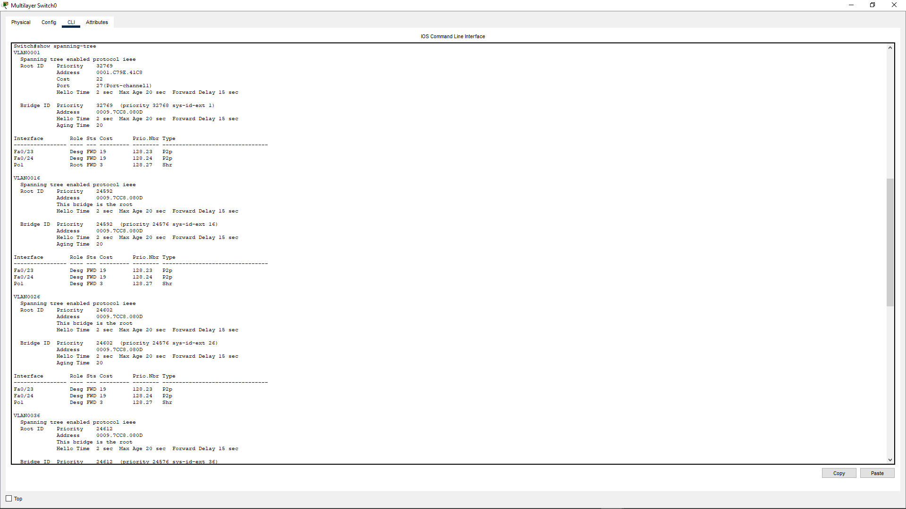

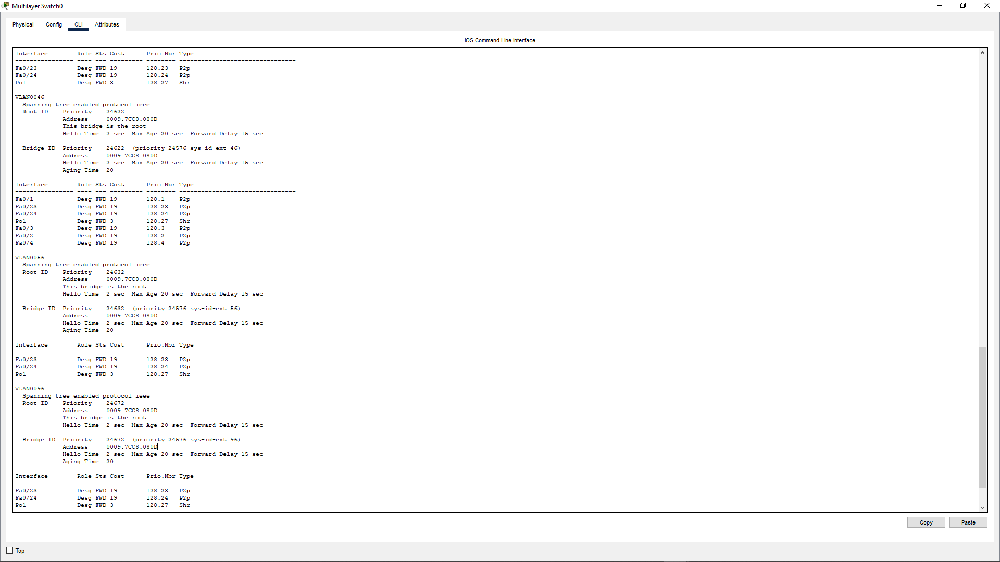


### 11.2 Evidencia del comando `show etherchannel summary`

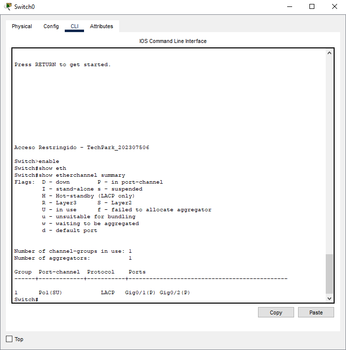


### 11.3 Evidencia del comando `show interfaces trunk`

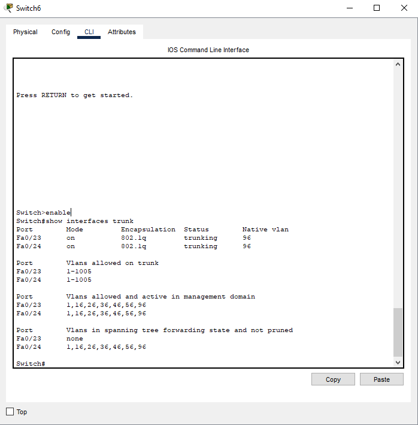

### 11.4 Evidencia de Pings exitosos y fallidos

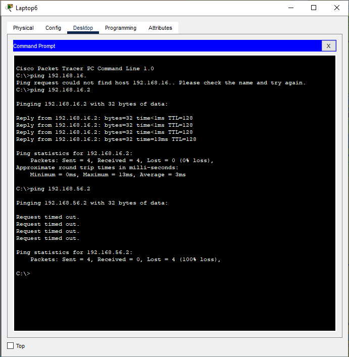

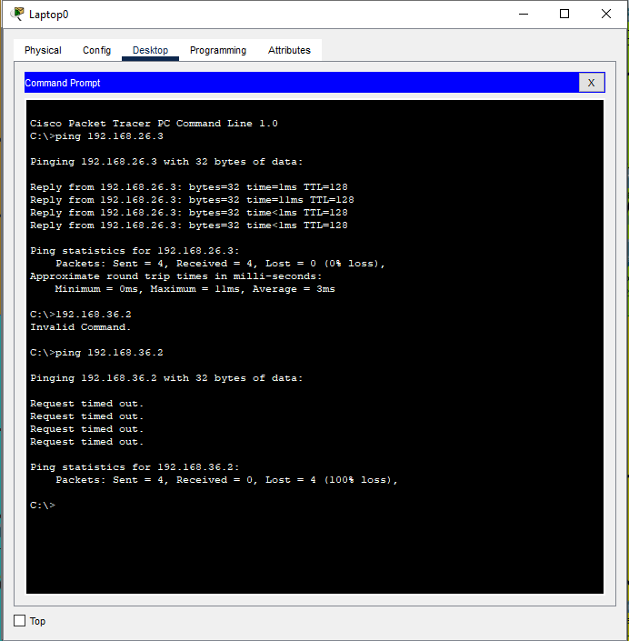

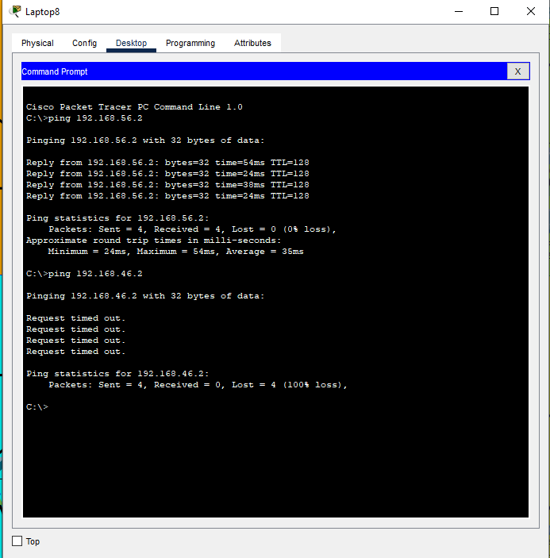
