# UNIVERSIDAD DE SAN CARLOS DE GUATEMALA

## FACULTAD DE INGENIERÍA

### REDES DE COMPUTADORAS 1

### CATEDRÁTICO: Ing. PEDRO PABLO HERNANDEZ RAMIREZ

### TUTOR ACADÉMICO: CESAR FERNANDO SAZO QUISQUINAY

<br>

| **Nombre**                     | **Carnet** |
| ------------------------------ | ---------: |
| Andrea Fernanda Hernández Xoná |  202307839 |
| Jorge Ivan Samayoa Sian        |  202307506 |
| Angel Jose Cardenas Pocon      |  202304063 |

<br>

**SECCIÓN:** A

## **Guatemala, 24 de octubre de 2026**

# Introduccion:

El presente manual técnico documenta el diseño, la implementación y las pruebas de funcionamiento de la infraestructura de red de **BanTech GT**, una entidad financiera que requiere una comunicación confiable entre sus sedes, sus áreas administrativas y su centro de datos.

El proyecto se desarrolló en Cisco Packet Tracer, implementando una arquitectura multisede compuesta por un backbone principal y cuatro áreas operativas: Sede Occidente, Sede Norte, Sede Oriente y Data Center y Sede Central. Para organizar el tráfico, se utilizaron VLAN, direccionamiento IP mediante subnetting, enrutamiento inter-VLAN y protocolos de enrutamiento dinámico y estático.

Cada sede utiliza tecnologías seleccionadas según sus necesidades operativas. Occidente emplea OSPF para el intercambio de rutas; Norte utiliza EIGRP; Oriente utiliza RIPv2 debido a su condición de infraestructura legada; y el Data Center utiliza rutas estáticas para mantener un control explícito sobre el acceso a sus redes. El backbone integra estos dominios mediante puntos de redistribución.

Asimismo, se implementaron mecanismos de redundancia y alta disponibilidad, como Rapid PVST+, HSRP y EtherChannel, con el propósito de reducir los puntos únicos de falla, mejorar la continuidad de los servicios y permitir caminos alternativos de comunicación.

Finalmente, se documentan las configuraciones relevantes, las decisiones de diseño, las tablas de direccionamiento y las pruebas realizadas para verificar la conectividad entre VLAN, sedes y servidores, así como el comportamiento de la infraestructura ante posibles fallos.

# Objetivos:

## Objetivo general

Diseñar, implementar y documentar una infraestructura de red multisede para BanTech GT mediante Cisco Packet Tracer, integrando segmentación por VLAN, direccionamiento IP, protocolos de enrutamiento y mecanismos de redundancia que permitan mantener una comunicación eficiente y confiable entre las diferentes áreas de la organización.

## Objetivos específicos

1. **Diseñar una topología de red multisede** que permita interconectar el backbone, las sedes regionales y el Data Center, considerando las necesidades operativas de cada área.

2. **Implementar la segmentación mediante VLAN y el direccionamiento IP** para organizar los dispositivos según su función, optimizar el uso de las direcciones disponibles y separar los dominios de broadcast.

3. **Configurar los protocolos de enrutamiento correspondientes a cada sede**, utilizando OSPF en Occidente, EIGRP en Norte, RIPv2 en Oriente y rutas estáticas en el Data Center, integrados mediante los puntos de redistribución del backbone.

4. **Implementar mecanismos de alta disponibilidad**, mediante Rapid PVST+, HSRP y EtherChannel, para proporcionar caminos alternativos, mantener la disponibilidad de los gateways y reducir el impacto de fallos físicos.

5. **Validar el funcionamiento de la infraestructura** mediante pruebas de conectividad, revisión de tablas de enrutamiento y simulación de fallos, documentando los resultados obtenidos y las configuraciones más importantes.

## 1. Capturas de la Implementación de la Topología

## 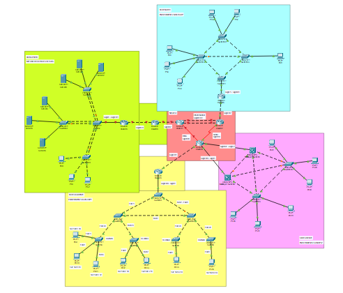

## 2. Justificación Técnica de Elección de Topologías y Mapeo Lógico

### Backbone Core (Núcleo)

El backbone constituye el núcleo de comunicación entre las distintas áreas de la organización. Su función principal es transportar el tráfico entre las sedes, intercambiar información de enrutamiento y permitir la integración de redes que utilizan diferentes protocolos.

Para cumplir esta función, se diseñó una infraestructura con dispositivos de Capa 3, enlaces redundantes, agregación de enlaces y puntos de redistribución. También se utilizaron distintos medios físicos para representar las conexiones de fibra óptica, Ethernet y WAN mediante enlaces seriales

- **Topología:** Malla parcial redundante con agregación de ancho de banda.
- **Tolerancia a fallos:** Se utilizaron múltiples medios físicos (fibra, ethernet, serial) y agregación mediante EtherChannel. Si un enlace falla, el tráfico se redirige dinámicamente.
- **Contexto:** Garantiza la convergencia de protocolos (RIP, OSPF, EIGRP, Estáticas) mediante puntos de redistribución cruzada en R-Nucleo_Inf y R-Frontera, soportando el tráfico transaccional crítico del corporativo.

**Qué problema resuelve?**

Evita que cada sede funcione como una red aislada y permite que sus dispositivos alcancen las redes remotas, incluidos los servicios alojados en el Data Center.

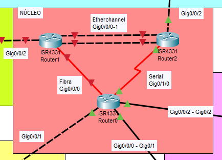

### Sede Occidente (Agencia Regional Comercial)

- **Switch Principal:** Switch0 (VTP Server).
- **Enlaces Troncales:** gig0/1, fa0/1, fa0/2. Puertos de acceso configurados según la VLAN.
- **Topología:** Estrella extendida.
- **Justificación:** Se eligió esta topología junto con la técnica _Router-on-a-Stick_ para mantener un diseño jerárquico fácil de administrar mediante VTP.
- **Tolerancia a fallos:** Aísla los dominios de broadcast, asegurando que un fallo masivo en el área de Asesores no detenga las transacciones de Cajas.

**¿Qué problema resuelve?**

Permite mantener separadas las operaciones de cajas, asesores, gerencia y seguridad, al mismo tiempo que posibilita la comunicación autorizada entre estas redes y el resto de la infraestructura.

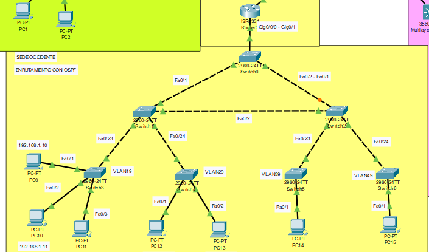

### Sede Norte (Centro de Autorización de Créditos)

- **Switch Principal:** Switch11 (Root Bridge forzado).
- **Enlaces Troncales:** Interconexiones Fa0/1 a Fa0/4 y Gig0/1 hacia R-Norte.
- **Topología:** Híbrida (Anillo/Diamante).
- **Justificación:** Los analistas de riesgo no pueden quedarse sin red. El diseño de anillo físico ofrece múltiples caminos hacia el switch principal.
- **Tolerancia a fallos:** La redundancia de Capa 2 es manejada por Rapid PVST+, mitigando bucles y conmutando caminos instantáneamente si un cable se corta.

**¿Qué problema resuelve?**

Reduce la dependencia de un único enlace físico y permite mantener la comunicación cuando falla una conexión, siempre que exista un camino alternativo funcional.

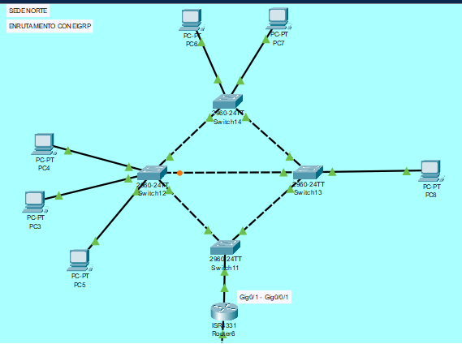

### Sede Oriente (Centro Financiero Legado)

- **Switch Principal:** MS0-Oriente (Active) y MS1-Oriente (Standby).
- **Enlaces Troncales:** Enlaces entre switches de capa 2 y multicapas.
- **Topología:** Distribución Multicapa en cascada redundante.
- **Justificación:** Al ser una sede legada crítica, se requería alta disponibilidad en el gateway de Capa 3 sin depender de un solo router físico.
- **Tolerancia a fallos:** Se implementó HSRP. Si el switch MS0 pierde energía o conexión, MS1 asume automáticamente la IP Virtual sin que los usuarios finales pierdan conexión al núcleo.

**¿Qué problema resuelve?**

Disminuye la dependencia de un único switch multicapa como gateway y permite que los usuarios mantengan su puerta de enlace configurada ante una conmutación hacia el dispositivo de respaldo.

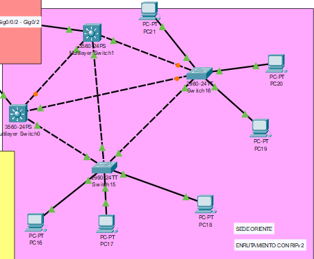

La distribución de los protocolos de enrutamiento permite representar distintos escenarios empresariales: una sede comercial que utiliza OSPF, una región de autorización de créditos que utiliza EIGRP, una sede financiera legada que utiliza RIPv2 y un Data Center que mantiene rutas estáticas.

### Data Center y Sede Central (Alta Seguridad)

- **Routers:** R-Central2 (Acceso Estático) y R-Central1 (Redistribución).
- **Topología:** Redundancia de enlaces físicos en Capa 2 y enrutamiento estático aislado.
- **Justificación:** El uso de EtherChannel (PAgP) entre los switches de distribución y el router agrupa los cables físicos para multiplicar el ancho de banda disponible, ideal para ráfagas masivas de servidores.
- **Tolerancia a fallos:** El enrutamiento estático aísla los servidores del núcleo previniendo ataques, mientras que el EtherChannel garantiza que si un cable se rompe, el canal lógico sigue transmitiendo.

**¿Qué problema resuelve?**

Permite controlar explícitamente las rutas hacia los servicios críticos y proporciona agregación de enlaces en las conexiones donde se implementó EtherChannel.

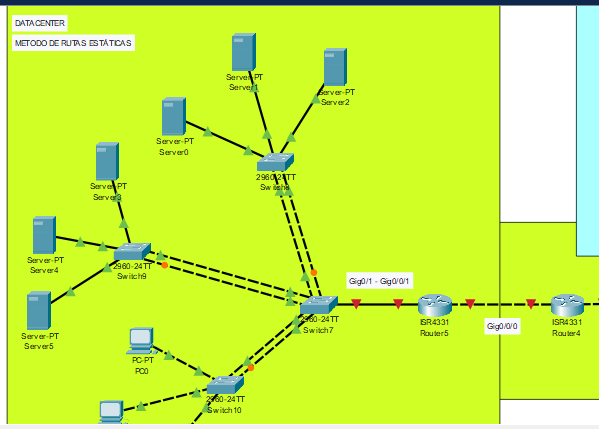

**Importante**:

La infraestructura incorpora mecanismos destinados a reducir el impacto de las fallas. Rapid PVST+ administra los caminos redundantes de Capa 2; HSRP proporciona una dirección IP virtual para el gateway de las VLAN de Oriente; y EtherChannel agrupa enlaces físicos en un canal lógico.

En conjunto, estas tecnologías permiten mejorar la disponibilidad de la red y facilitan la recuperación ante determinados fallos de enlaces o dispositivos. Su funcionamiento debe comprobarse mediante las pruebas de conectividad y redundancia incluidas en este manual.

## Justificación de las herramientas y tecnologías generales

Además de explicar cada sede, conviene incluir una tabla breve que resuma las tecnologías utilizadas en todo el proyecto.

| Tecnología           | ¿Por qué se utilizó?                                                                          | Beneficio principal                                                       |
| -------------------- | --------------------------------------------------------------------------------------------- | ------------------------------------------------------------------------- |
| Cisco Packet Tracer  | Permite construir y probar la infraestructura de manera simulada.                             | Validación del diseño sin requerir equipos físicos.                       |
| VLAN                 | Separa las áreas funcionales de cada sede.                                                    | Organización del tráfico y reducción de dominios de broadcast.            |
| Subnetting VLSM/FLSM | Permite asignar redes IP según las necesidades de cada segmento.                              | Aprovechamiento del direccionamiento disponible.                          |
| Troncales 802.1Q     | Transportan tráfico de varias VLAN por un mismo enlace.                                       | Simplificación de las conexiones entre switches y dispositivos de Capa 3. |
| VTP                  | Facilita la distribución de información de VLAN entre switches compatibles del mismo dominio. | Administración centralizada de las VLAN.                                  |
| OSPF                 | Permite intercambiar rutas dinámicamente en Occidente.                                        | Actualización de rutas ante cambios en la topología.                      |
| EIGRP                | Permite intercambiar rutas dinámicamente en Norte.                                            | Aprendizaje de redes remotas y convergencia ante cambios.                 |
| RIPv2                | Proporciona enrutamiento dinámico en Oriente.                                                 | Integración de la sede legada.                                            |
| Rutas estáticas      | Definen explícitamente las rutas del Data Center.                                             | Control directo del encaminamiento.                                       |
| Redistribución       | Intercambia rutas entre dominios de enrutamiento distintos.                                   | Comunicación entre las sedes.                                             |
| Rapid PVST+          | Administra los enlaces redundantes de Capa 2.                                                 | Prevención de bucles y recuperación ante ciertos fallos.                  |
| HSRP                 | Proporciona un gateway virtual compartido.                                                    | Redundancia de la puerta de enlace.                                       |
| EtherChannel         | Agrupa enlaces físicos compatibles en un canal lógico.                                        | Mayor capacidad agregada y tolerancia al fallo de un enlace individual.   |

## 3. Extractos de Configuraciones Críticas

**Redistribución OSPF a EIGRP (Aplicado en Router2):**

```cisco
router eigrp 10
 redistribute ospf 1 metric 100000 100 255 1 1500
router ospf 1
 redistribute eigrp 10 subnets
```

**Alta Disponibilidad HSRP (Aplicado en MS0-Oriente):**

```cisco
interface Vlan89
 ip address 192.168.8.2 255.255.255.192
 standby 89 ip 192.168.8.1
 standby 89 priority 110
 standby 89 preempt
```

**Agregación EtherChannel (Aplicado en Núcleo / Data Center):**

```cisco
interface GigabitEthernet0/0
 channel-group 1
interface Port-channel1
 ip address 192.168.13.37 255.255.255.252
```

---

## 4. Tablas de Direccionamiento y VLANs

### Tabla de Subnetting General

| ÁREA            | VLAN | HOSTS | IP ASIGNADA       | MÁSCARA           |
| :-------------- | :--- | :---- | :---------------- | :---------------- |
| **NÚCLEO**      | -    | -     | `192.168.13.0/30` | `255.255.255.252` |
| **OCCIDENTE**   | 19   | 45    | `192.168.1.0/26`  | `255.255.255.192` |
|                 | 29   | 30    | `192.168.2.0/26`  | `255.255.255.192` |
|                 | 39   | 10    | `192.168.3.0/28`  | `255.255.255.240` |
|                 | 49   | 12    | `192.168.4.0/28`  | `255.255.255.240` |
| **NORTE**       | 59   | 50    | `192.168.5.0/26`  | `255.255.255.192` |
|                 | 69   | 25    | `192.168.6.0/27`  | `255.255.255.224` |
|                 | 79   | 14    | `192.168.7.0/27`  | `255.255.255.224` |
| **ORIENTE**     | 89   | 40    | `192.168.8.0/26`  | `255.255.255.192` |
|                 | 99   | 60    | `192.168.9.0/26`  | `255.255.255.192` |
| **DATA CENTER** | 20   | 14    | `192.168.10.0/27` | `255.255.255.224` |
|                 | 30   | 28    | `192.168.11.0/27` | `255.255.255.224` |
|                 | 40   | 10    | `192.168.12.0/28` | `255.255.255.240` |

### Tabla de VLANs Asignadas

| Sede            | ID VLAN | Nombre / Área Funcional |
| :-------------- | :------ | :---------------------- |
| **Occidente**   | 19      | Cajas                   |
| **Occidente**   | 29      | Asesores                |
| **Occidente**   | 39      | Gerencia                |
| **Occidente**   | 49      | Seguridad               |
| **Norte**       | 59      | Analisis                |
| **Norte**       | 69      | Auditoria               |
| **Norte**       | 79      | Legal                   |
| **Oriente**     | 89      | Boveda                  |
| **Oriente**     | 99      | Plataforma              |
| **Data Center** | 20      | Core_BD                 |
| **Data Center** | 30      | Web_Apps                |
| **Data Center** | 40      | NOC                     |

---

## Conclusiones

1. El desarrollo de la infraestructura de BanTech GT permitió aplicar los conocimientos de diseño de redes multisede, segmentación mediante VLAN, direccionamiento IP y comunicación entre redes. La organización del backbone y de las sedes proporciona una estructura para interconectar las áreas comerciales, administrativas y de servicios centrales.

2. La utilización de diferentes métodos de enrutamiento permitió comprender la integración de dominios con características distintas. OSPF en Occidente, EIGRP en Norte, RIPv2 en Oriente y las rutas estáticas del Data Center cumplen funciones específicas dentro del diseño, mientras que la redistribución de rutas permite la comunicación entre estos entornos.

3. La implementación de VLAN y del enrutamiento inter-VLAN permitió organizar las redes según las funciones de cada departamento. Esta segmentación facilita la administración del tráfico y establece una base para aplicar políticas de acceso entre las distintas áreas.

4. Los mecanismos de redundancia aportan soluciones a diferentes necesidades de disponibilidad. Rapid PVST+ administra los caminos alternativos de Capa 2, HSRP proporciona redundancia para el gateway de Oriente y EtherChannel agrupa enlaces físicos para mejorar la capacidad agregada y tolerar la pérdida de uno de sus enlaces participantes.

5. Las pruebas de conectividad, la revisión de las tablas de enrutamiento y las simulaciones de fallos son fundamentales para comprobar que las configuraciones cumplen los objetivos establecidos. La documentación de estas pruebas permite identificar errores, verificar la propagación de rutas y evaluar el comportamiento de la infraestructura ante cambios en la conectividad.

En conclusión, el proyecto permitió desarrollar una propuesta de infraestructura de red para BanTech GT que integra segmentación, enrutamiento y mecanismos de redundancia en un entorno multisede. Su funcionamiento debe respaldarse mediante las evidencias obtenidas en Cisco Packet Tracer, demostrando la conectividad entre las sedes y la respuesta de los mecanismos de alta disponibilidad ante los fallos evaluados.

---

## 5. Capturas de Pruebas de Conectividad y Fallos

**Configuración de VLAN:** Identificación de las VLAN y sus nombres.
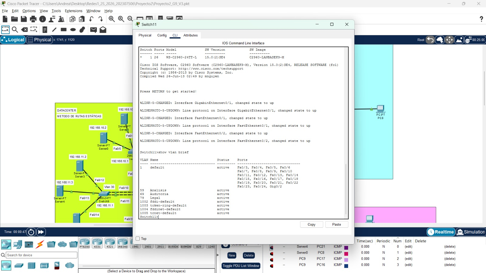

**Enlaces troncales:** Transporte de las VLAN necesarias.
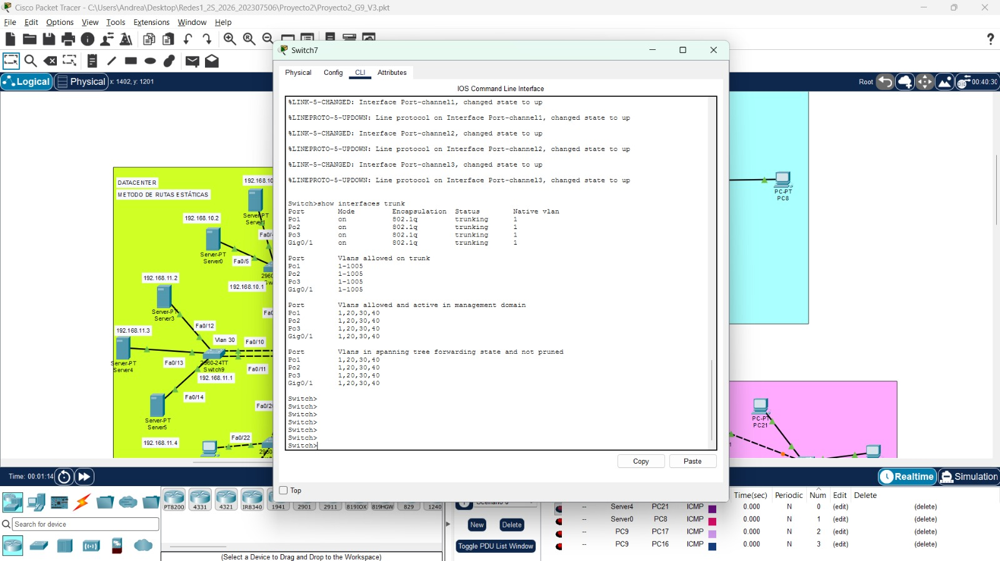
**Tablas de rutas:** Presencia de redes locales y remotas.

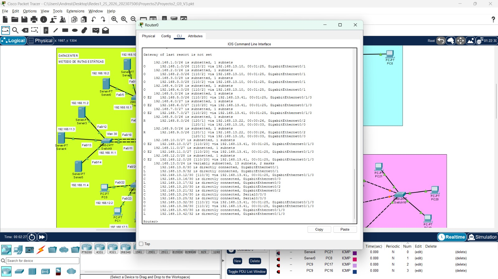
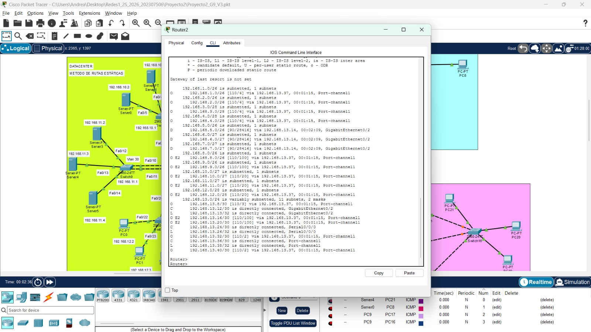
**EtherChannel:** Estado del canal lógico y sus interfaces participantes.
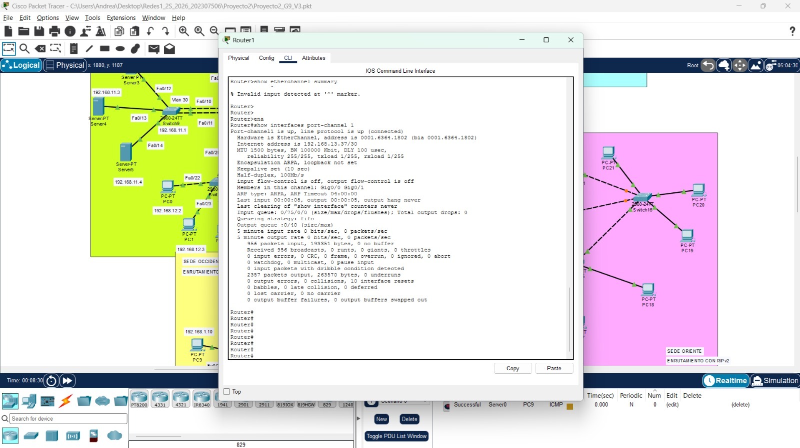
**Ping entre VLAN:** Comunicación entre redes de una misma sede.
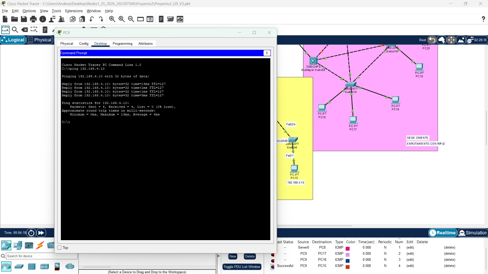
**Ping entre sedes:** Conectividad extremo a extremo.
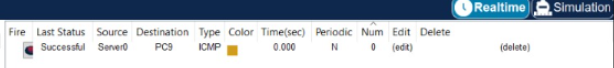
**HSRP** Cambio de equipo activo y recuperación del gateway.
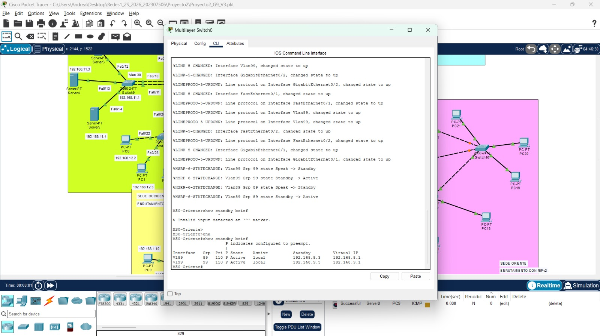
**Rapid PVST+** Cambio de estado de los puertos y uso del camino alternativo.
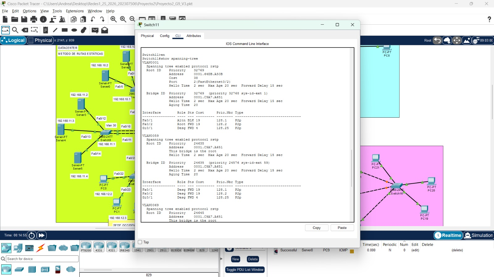
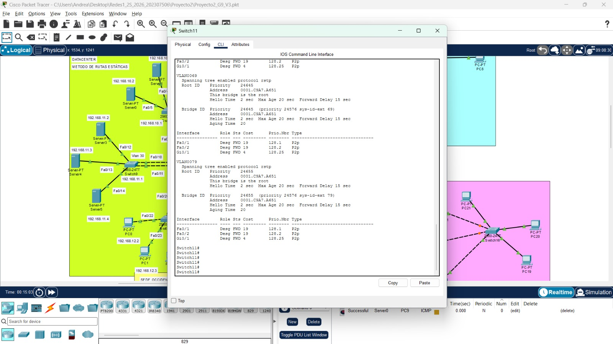
**Evidencias de diferentes pings**
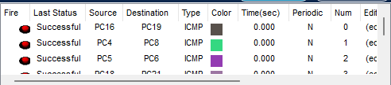
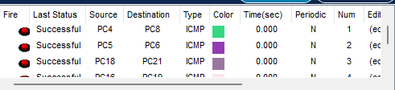
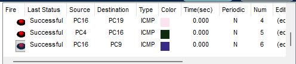
